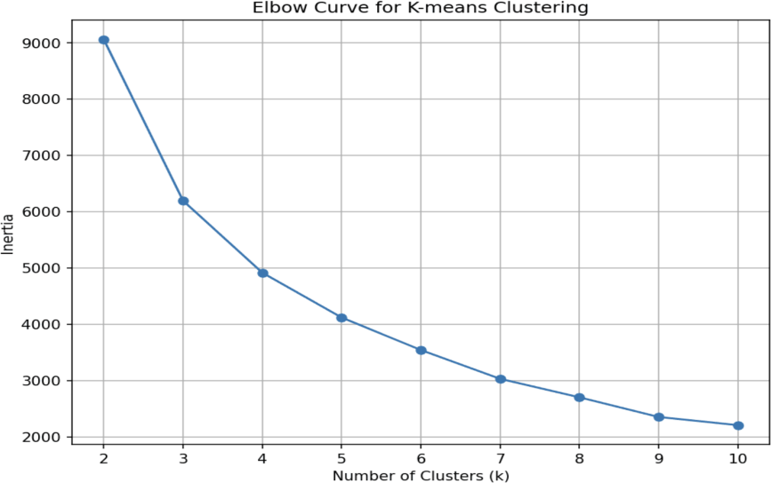
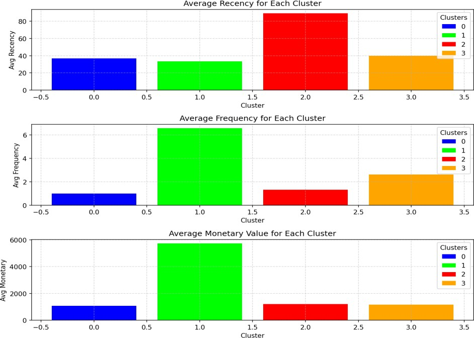
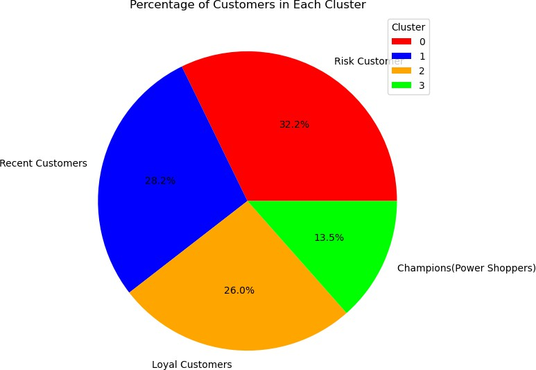
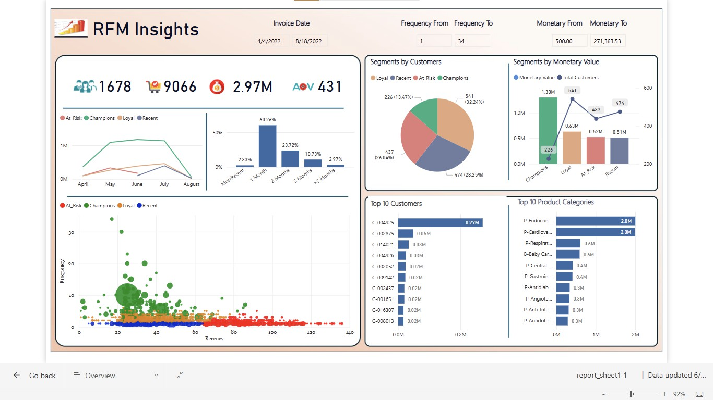
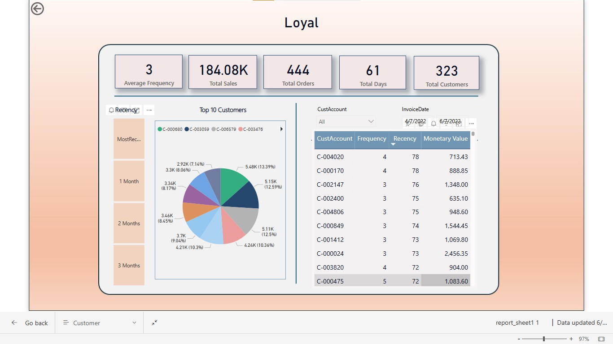
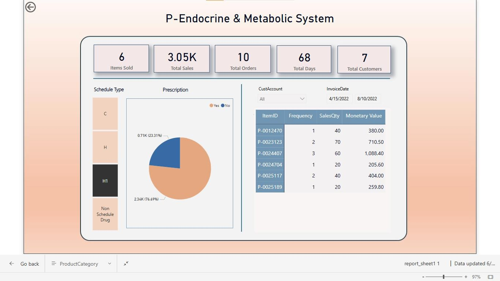

# Customer Churn-Risk Segmentation (RFM + K-Means)

Segments customers by buying behaviour (Recency, Frequency, Monetary value) with K-Means to flag churn-risk groups for targeted retention.

Originated as an internship project at CodeValue Technologies (Python, Power BI).

## Method
1. Clean data: drop missing `CustomerID`, remove non-positive quantity/price.
2. Compute RFM per customer (snapshot = last invoice date + 1 day).
3. Log-transform + standardize RFM.
4. Elbow method (k=2–10) and silhouette score; fit K-Means with k=4.
5. Name segments from cluster averages: Champions, Loyal, Recent, At Risk.

## Run
```bash
pip install -r requirements.txt
python churn_rfm_segmentation.py
```
The script downloads the dataset automatically into `data/Online_Retail.xlsx` on first run. If the download fails, get it from https://archive.ics.uci.edu/dataset/352/online+retail and save it at that path.

Outputs (in `outputs/`): `rfm_segments.csv`, `elbow_curve.png`, `segment_profiles.png`, `segment_share.png`.

## Results




## Dataset
UCI Online Retail (transactions of a UK online retailer, 2010–2011).

## Power BI Report
Interactive dashboard ("RFM Insights") built in Power BI to visualise the RFM segments: KPI cards, segment share, monetary value by segment, recency/frequency scatter, top customers and product categories, with drill-through pages.

**Overview**


**Drill-through: segment (Loyal)**


**Drill-through: product category**


> Note: the dashboard was built on a separate sales dataset (customer/product-category data), not on the Online Retail data used by the Python script. The `.pbix` file is not included.

## Notes
- This is behavioural segmentation; no supervised churn label is trained.

## Author
<Swetha Dhanajayan>
